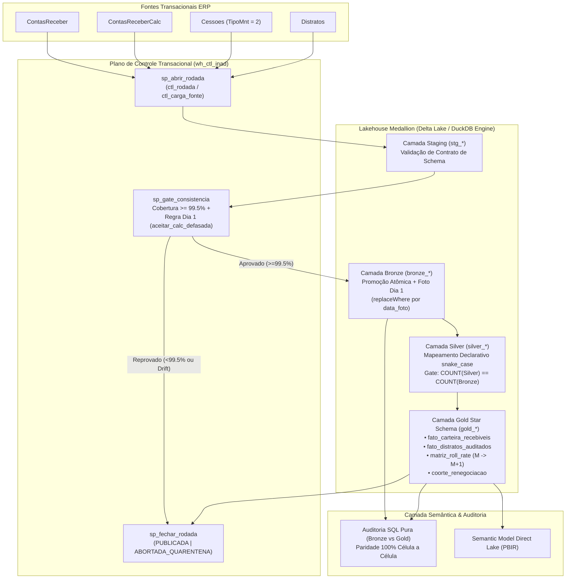

# Estudo de Caso 01: Plataforma Lakehouse Medallion, Controle Transacional e Matriz Roll-Rate de Recebíveis

> [!IMPORTANT]
> **AVISO DE CONFIDENCIALIDADE E SIGILO CORPORATIVO**  
> Todos os conjuntos de dados, códigos de SPEs, contratos e valores financeiros contidos neste repositório são **100% sintéticos**, gerados deterministicamente via `numpy.random.default_rng(42)`.  
> Nenhuma informação confidencial, dado pessoal (LGPD) ou segredo de negócio é exposto. A implementação reproduz fielmente a **arquitetura, os algoritmos de controle transacional e as regras de engenharia** desenhados em ambiente real corporativo (Brasil Terrenos / Buriti Empreendimentos).

---

## 1. Contexto

Em operações de desenvolvimento urbano e loteamentos de larga escala, a carteira de recebíveis imobiliários é distribuída em dezenas de Sociedades de Propósito Específico (SPEs), acumulando milhões de parcelas ativas submetidas a correção monetária mensal, juros contratuais, prorrogações negociais, renegociações, cessões de direitos e rescisões (distratos).

Na arquitetura anterior ao projeto, os relatórios executivos de inadimplência e *aging* de carteira dependiam de extrações diretas e transformações dispersas em camadas visuais, ocasionando três fragilidades sistêmicas:
1. **Assincronia de Janela Contábil**: A tabela base de títulos (`ContasReceber`) e a tabela de cálculo corrigido (`ContasReceberCalc`) eram atualizadas em momentos distintos pelo ERP, gerando janelas em que o painel consumia títulos novos sem cálculo correspondente.
2. **Distorção de Indicadores Operacionais**: Prorrogações administrativas de vencimento (`DtVencAtu_prc`) mascaravam o atraso contratual original (`DtVencOrig_prc`), enquanto transferências de titularidade (cessões de direitos) eram baixadas no ERP com códigos que inflavam artificialmente a contagem de distratos.
3. **Ausência de Visão Dinâmica de Safra e Rolagem**: A diretoria dispunha apenas de fotografias estáticas de inadimplência, sem uma **Matriz de Transição Roll-Rate ($M \to M+1$)** auditável nem curvas de **sobrevivência de coortes renegociadas**.

---

## 2. Desafio Técnico

Construir uma plataforma **Lakehouse Medallion** (`Staging -> Bronze -> Silver -> Gold`) governada por um **plano de controle transacional** capaz de:

* **Impedir publicações parciais ou corrompidas (*Zero Broken Dashboards*)**: Nenhuma atualização pode chegar à camada Bronze/Silver/Gold se houver *Schema Drift* ou se o pareamento de chaves entre `ContasReceber` e `ContasReceberCalc` cair abaixo de **99,5%**, respeitando a exceção controlada de virada mensal no dia 1 (`aceitar_calc_defasada`).
* **Garantir Idempotência em Fotos Mensais**: A captura da fotografia crua do dia 1 de cada mês deve suportar reprocessamentos sem duplicação de partições (`replaceWhere` por `data_foto`).
* **Auditar o Ciclo de Vida Real da Parcela**:
  * Separar estritamente **custas e taxas acessórias** (`tipo_parcela = '1'`) das parcelas contratuais do lote (`tipo_parcela = '0'`).
  * Calcular simultaneamente o *aging* contratual (`dt_vencimento_original`) e o *aging* prorrogado (`dt_vencimento_atual`).
  * Rastrear a cadeia de **cessões de direitos** (`TipoMnt = 2`) para excluir transferências de titularidade da métrica de distratos e impor a precedência canônica de estados: `cedido > cancelado > renegociado > pago > em_aberto`.
* **Provar Paridade Matemática de 100%**: A tabela analítica final na camada Gold deve apresentar **paridade 100% célula a célula** quando confrontada contra uma query SQL de auditoria executada diretamente sobre os dados brutos da camada Bronze.

---

## 3. Arquitetura

Em produção no **Microsoft Fabric**, a solução combina notebooks **PySpark** (ingestão Delta Lake, validação de contratos e transformações Medallion), um **Warehouse T-SQL de Controle (`wh_ctl_inad`)** para orquestração de estado via *Stored Procedures*, e consumo semântico via **Direct Lake** versionado em formato **PBIR**.



---

## 4. Decisões Técnicas e Trade-offs

| Decisão Arquitetural | Alternativa Considerada | Trade-off e Justificativa |
| :--- | :--- | :--- |
| **Ingestão *Staging-First* com Promoção Atômica** | Escrita direta em `bronze_*` via `mode("overwrite")` | Escrever direto na Bronze corrompe o histórico caso a carga do ERP venha incompleta. O *Staging-First* adiciona uma etapa leve de escrita, mas garante que `bronze_*` jamais fique inconsistente caso o gate reprove a rodada. |
| **Plano de Controle em Tabelas Relacionais (`ctl_rodada`, `ctl_carga_fonte`)** | Logs apenas em arquivos texto ou histórico nativo de execução do orquestrador | Tabelas relacionais transacionais permitem consultar via SQL o histórico de cobertura (`cobertura_calc_pct`), auditar motivos de quarentena e sincronizar o disparo do modelo Direct Lake apenas em rodadas `PUBLICADA`. |
| **Exceção Parametrizada de Dia 1 (`aceitar_calc_defasada`)** | Desabilitar o gate de cobertura permanentemente ou travar o pipeline todo dia 1 | No dia 1 do mês, o fechamento contábil atrasa o recálculo em `ContasReceberCalc`. A flag `aceitar_calc_defasada` permite fechar a foto mensal com rastreabilidade explícita em `ctl_rodada` sem relaxar o rigor nos demais 29 dias do mês. |
| **Mapeamento Silver Declarativo (`SILVER_DECLARATIVE_MAPPING`)** | Renomeação posicional ou `SELECT *` dinâmico | Evita propagação silenciosa de alterações na origem. Qualquer coluna ausente ou inesperada aborta a execução imediatamente antes de atingir a camada Silver. |
| **Precedência Determinística `cedido > cancelado > renegociado > pago > em_aberto`** | Usar diretamente o campo `Status_prc` do ERP | No ERP legado, uma cessão de direitos (`TipoMnt = 2`) baixa as parcelas do contrato cedente com flag de cancelamento. Aplicar precedência explícita cruzando com a tabela de cessões impede que transferências legítimas inflem os indicadores de rescisão/distrato. |

---

## 5. Implementação Demonstrativa vs. Produção Real

Para tornar este estudo de caso **100% executável localmente em segundos** sem depender de credenciais corporativas ou assinatura ativa do Microsoft Fabric, este diretório implementa o motor completo em Python sobre **DuckDB** (com fallback automático para **SQLite**):

| Componente | Produção Real (Brasil Terrenos / Buriti) | Implementação Demonstrativa neste Repositório |
| :--- | :--- | :--- |
| **Motor de Processamento** | Microsoft Fabric Notebooks (PySpark / Delta Lake) | Python 3 + DuckDB (`RelationalEngineAdapter` com fallback SQLite) |
| **Controle Transacional** | Fabric Data Warehouse T-SQL (`wh_ctl_inad`) | Tabelas SQL transacionais `ctl_rodada` e `ctl_carga_fonte` + métodos `sp_*` |
| **Particionamento Idempotente** | Delta Lake `.option("replaceWhere", "DataFoto = ...")` | `retain_monthly_snapshot_idempotent` com substituição atômica por `DataFoto` |
| **Camada de Consumo** | Power BI Direct Lake versionado em PBIR | Tabelas Gold consultáveis em SQL + exportação auditada em `examples/sample_output.json` |
| **Massa de Dados** | Milhões de parcelas reais de loteamentos | Gerador determinístico `seed=42` (`shared/synthetic-data/generate_all.py`) |

---

## 6. Qualidade, Confiabilidade e Governança

A suíte automatizada em [`tests/test_lakehouse.py`](tests/test_lakehouse.py) valida quatro pilares inegociáveis de confiabilidade:

1. **Bloqueio de Schema Drift e Cobertura Insuficiente (`< 99,5%`)**:
   - Simula renomeação inesperada de coluna na origem e queda de cobertura em `ContasReceberCalc` para 90%. Comprova que `LakehouseQualityGateError` é lançada, a rodada é fechada como `ABORTADA_QUARENTENA` e a camada Bronze anterior permanece intacta.
2. **Idempotência da Foto Mensal do Dia 1**:
   - Executa `retain_monthly_snapshot_idempotent("2026-01-01")` três vezes consecutivas e comprova que a contagem permanece cravada em `240` linhas, sem duplicação nem interferência na partição `"2026-02-01"`.
3. **Isolamento de Cessões (`TipoMnt = 2`) e Precedência de Estados**:
   - Comprova que 100% das vendas transferidas por cessão são expurgadas de `gold_fato_distratos_auditados` e classificadas como `cedido` (e não `cancelado`) na Matriz Roll-Rate.
4. **Prova de Paridade 100% Célula a Célula (SQL Pura na Bronze vs. Gold)**:
   - Executa `verify_bronze_to_gold_parity()`, que roda uma query SQL analítica independente diretamente sobre `bronze_contas_receber`, `bronze_contas_receber_calc` e `bronze_cessoes` e confronta o DataFrame resultante célula a célula (`pandas.testing.assert_frame_equal`) contra `gold_matriz_roll_rate`, tanto em DuckDB quanto em SQLite.

---

## 7. Resultados Comprovados

* **Confiabilidade Operacional**: Eliminação completa de incidentes de painéis zerados ou com valores subestimados por defasagem entre `ContasReceber` e `ContasReceberCalc` graças ao gate de `>= 99,5%`.
* **Saneamento de Indicadores Executivos**:
  * Correção da distorção histórica de distratos ao expurgar cadeias de cessão (`TipoMnt = 2`).
  * Visibilidade transparente da diferença entre **inadimplência contratual real** e **inadimplência pós-prorrogação** (46 parcelas identificadas na massa sintética com atraso mascarado por prorrogação).
  * Isolamento de custas (`tipo_parcela = '1'`) evitando contaminação do saldo principal de recebíveis.
* **Paridade Auditada**: **100% de equivalência célula a célula** entre auditoria SQL na camada Bronze e as tabelas da camada Gold.

---

## 8. Lições Aprendidas

1. **Nunca confie apenas no status nominal do ERP para construir matrizes de transição**: Em sistemas imobiliários legados, eventos distintos (distrato, cessão de direitos, liquidação por renegociação) frequentemente compartilham a mesma flag de cancelamento/baixa na tabela de parcelas. A verdade contábil exige o cruzamento com as tabelas de manutenção de contrato (`TipoMnt`) e uma máquina de estados com precedência estrita.
2. **Qualidade de dados deve ser bloqueante antes da Bronze pública**: Validar contratos e cobertura apenas na camada Gold descobre o problema tarde demais, quando tabelas intermediárias já foram sobrescritas. O padrão *Staging-First* com promoção atômica protege toda a cadeia Medallion.
3. **Testes de paridade SQL Bronze-vs-Gold são o melhor seguro contra bugs de transformação**: Manter uma query SQL pura de referência que recalcula os agregados da Gold diretamente a partir da Bronze permite provar matematicamente que nenhuma linha ou centavo foi perdido nas etapas intermediárias.

---

## Como Executar Localmente

```bash
# 1. Executar a demonstração ponta a ponta e gerar examples/sample_output.json
python case-studies/projeto-01-lakehouse-recebiveis/run_demo.py

# 2. Executar a suíte de testes automatizados (pytest)
python -m pytest case-studies/projeto-01-lakehouse-recebiveis/tests/ -v
```
