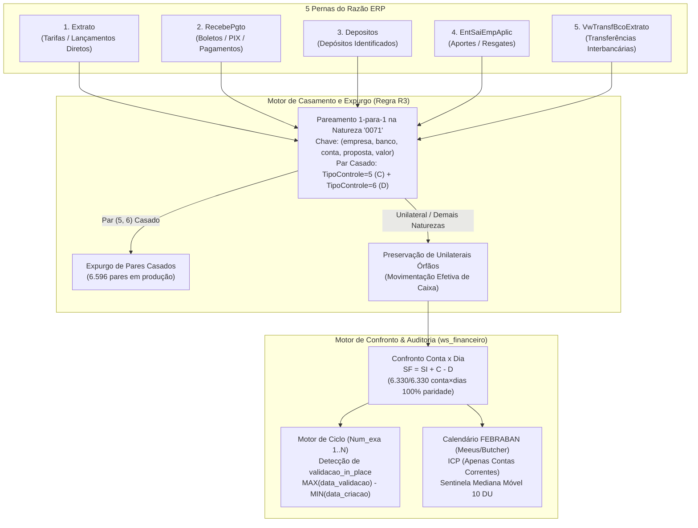

# Estudo de Caso 02: Motor de Conciliação Bancária, Recálculo de 5 Pernas Contábeis e Auditoria de Ciclos

> [!IMPORTANT]
> **AVISO DE CONFIDENCIALIDADE E SIGILO CORPORATIVO**  
> Todos os dados bancários, contas correntes, aplicações, lançamentos de razão e códigos de SPEs presentes neste repositório são **100% sintéticos**, gerados deterministicamente via `numpy.random.default_rng(42)`.  
> Nenhuma conta bancária real, extrato ou transação financeira corporativa foi exposta. O código demonstra exclusivamente os **algoritmos de engenharia contábil, expurgo de partidas transitórias e auditoria de ciclos** desenvolvidos em produção no ambiente `ws_financeiro` (Brasil Terrenos / Buriti Empreendimentos).

---

## 1. Contexto

Em grupos econômicos do setor de loteamentos e incorporação com dezenas de SPEs e centenas de contas bancárias ativas em múltiplos bancos, a conciliação bancária diária é o coração do fechamento financeiro e contábil.

Antes da implementação deste motor no **Microsoft Fabric (`ws_financeiro`)**, o processo de fechamento semanal de conciliação enfrentava gargalos severos:
1. **Fragmentação em 5 Tabelas de Razão no ERP**: Os lançamentos que compõem a movimentação bancária no ERP não residem em uma tabela única, mas distribuídos em **5 pernas independentes** (`Extrato`, `RecebePgto`, `Depositos`, `EntSaiEmpAplic` e `VwTransfBcoExtrato`).
2. **Inflação Artificial por Lançamentos Transitórios de Intermediação**: Operações de cobrança e repasse geravam lançamentos internos espelhados na natureza `'0071'` (`TipoControle = 5` a crédito e `TipoControle = 6` a débito) que inflavam tanto os créditos quanto os débitos do ERP sem existir no extrato bancário oficial.
3. **Cegueira sobre o Tempo Real de Conciliação**: O ERP sobrescrevia o status de conciliação (`Status_exa = 2`) diretamente sobre o snapshot inicial (`Num_exa = 1`) em parte dos lançamentos, ocultando o atraso operacional, enquanto o indicador de cobertura de extratos (ICP) era distorcido por contas de aplicação financeira que não emitem extrato diário.

---

## 2. Desafio Técnico

Projetar e implementar um motor determinístico de conciliação e auditoria capaz de:

* **Reconstruir o Razão Bancário pelas 5 Pernas do ERP**: Unificar `Extrato`, `RecebePgto`, `Depositos`, `EntSaiEmpAplic` e `VwTransfBcoExtrato` e confrontar cada `conta × dia` contra o extrato bancário oficial validando a equação fundamental:
  $$\text{SF} = \text{SI} + \text{C} - \text{D}$$
* **Isolar e Expurgar Pares Transitórios (`Regra R3`) sem Perder Lançamentos Reais**: Parear estritamente `1-para-1` os lançamentos `(TipoControle = 5, TipoControle = 6)` na natureza `'0071'` por `(cod_empresa, cod_banco, conta_bancaria, proposta, valor)` e expurgá-los, **preservando obrigatoriamente lançamentos `'0071'` unilaterais (órfãos)** que representam movimentação financeira efetiva.
* **Auditar o Ciclo de Conciliação sobre Múltiplos Snapshots (`Num_exa 1..N`)**: Calcular `status_inicial`, `status_final` e `dias_para_conciliar`, detectando automaticamente a anomalia de **`validacao_in_place`** (quando `Status_exa = 2` foi sobrescrito no próprio `Num_exa = 1`) através da diferença $\max(\text{data\_validacao}) - \min(\text{data\_criacao})$.
* **Construir o Calendário Bancário FEBRABAN e o ICP Fiel**: Calcular feriados móveis via **algoritmo astronômico de Meeus/Butcher para a Páscoa**, expurgar Contas de Aplicação do denominador diário do **ICP (Índice de Cobertura de Processamento)** e monitorar quedas abruptas de recepção de extratos com uma **sentinela baseada na mediana móvel de 10 dias úteis**.

---

## 3. Arquitetura



---

## 4. Decisões Técnicas e Trade-offs

| Decisão Técnica | Alternativa Considerada | Trade-off e Justificativa |
| :--- | :--- | :--- |
| **Pareamento 1-para-1 Explícito na Regra `R3` (`TipoControle 5 e 6` na natureza `'0071'`)** | Filtrar cegamente `WHERE natureza != '0071'` |Um filtro cego (`natureza != '0071'`) quebraria a paridade contábil nas contas onde houve lançamento `'0071'` unilateral real. O algoritmo de casamento por `(empresa, banco, conta, proposta, valor)` exige agrupamento adicional, mas garante precisão cirúrgica: remove apenas a fumaça contábil (pares casados) e preserva o caixa real. |
| **Detecção de `validacao_in_place` via $\max(\text{data\_validacao}) - \min(\text{data\_criacao})$** | Medir o ciclo apenas pela diferença de datas entre snapshots com `Status_exa = 0` e `Status_exa = 2` | Quando o ERP sobrescreve `Status_exa = 2` no `Num_exa = 1`, o registro nunca aparece com status `0` no histórico de snapshots. Usar $\max(\text{data\_validacao}) - \min(\text{data\_criacao})$ recupera o *lead time* verdadeiro e expõe a anomalia de sobrescrita. |
| **Algoritmo de Meeus/Butcher Nativo para Feriados Móveis FEBRABAN** | Tabelas estáticas manuais de feriados ou bibliotecas externas pesadas | Tabelas manuais expiram ou esquecem feriados bancários móveis (Carnaval, Sexta-Feira da Paixão, Corpus Christi). O algoritmo de Meeus/Butcher calcula o Domingo de Páscoa para qualquer ano em $\mathcal{O}(1)$ sem dependências externas. |
| **Separação de `CONTA_CORRENTE` vs `CONTA_APLICACAO` no Denominador do ICP** | Incluir todas as contas bancárias cadastradas no denominador diário | Contas de CDB/Aplicação só geram extrato em dias de movimentação ou fechamento mensal. Incluí-las no denominador diário subestimava artificialmente o ICP (ex.: de 100% para 85% na demonstração sintética). |

---

## 5. Implementação Demonstrativa vs. Produção Real

| Componente | Produção Real (`ws_financeiro` - Microsoft Fabric) | Implementação Demonstrativa neste Repositório |
| :--- | :--- | :--- |
| **Processamento das 5 Pernas** | PySpark Notebooks + Lakehouse Delta Tables no Microsoft Fabric | [`src/engine_conciliacao.py`](src/engine_conciliacao.py) (Pandas / NumPy / Python 3) |
| **Volume Auditado** | **6.330 conta×dias** auditados e **6.596 pares `R3`** expurgados | 34 conta×dias sintéticos (`seed=42`) e 40 pares `R3` casados + 1 órfão unilateral |
| **Auditoria de Snapshots** | Histórico diário de snapshots `Num_exa` no Lakehouse | `audit_reconciliation_cycles()` sobre snapshots `Num_exa 1..N` |
| **Monitoramento de Cobertura** | Data Activator / Relatório Direct Lake de Governança | `calculate_icp_and_coverage_sentinel()` com mediana móvel de 10 dias úteis |

---

## 6. Qualidade, Confiabilidade e Governança

A suíte automatizada em [`tests/test_conciliacao.py`](tests/test_conciliacao.py) garante a exatidão matemática de cada regra:

1. **Equação Fundamental de Saldo e Paridade das 5 Pernas (`test_accounting_equation_and_five_legs_parity`)**:
   - Prova que, sem o expurgo `R3`, 0% dos `conta×dias` batem créditos e débitos com o extrato oficial; após aplicar `R3`, **100% dos `conta×dias` atingem paridade exata** ($\text{SF} = \text{SI} + \text{C} - \text{D}$).
2. **Casamento `R3` vs. Preservação de Órfãos (`test_r3_purge_matched_pairs_vs_preserve_orphans`)**:
   - Prova que pares `(TipoControle=5, TipoControle=6)` na natureza `'0071'` são removidos, enquanto lançamentos `'0071'` unilaterais permanecem intactos no razão.
3. **Detecção de `validacao_in_place` (`test_reconciliation_cycle_and_in_place_overwrite_detection`)**:
   - Valida o cálculo de `dias_para_conciliar` tanto para o fluxo padrão (`0 -> 2`) quanto para o caso de sobrescrita no snapshot 1 (`2 -> 2`).
4. **Algoritmo de Meeus/Butcher e Calendário FEBRABAN (`test_meeus_butcher_easter_and_febraban_holidays`)**:
   - Valida as datas exatas de Páscoa, Carnaval, Sexta-Feira da Paixão e Corpus Christi para múltiplos anos (2024–2027).
5. **ICP e Sentinela de 10 Dias Úteis (`test_icp_calculation_and_moving_median_sentinel`)**:
   - Comprova o expurgo de `CONTA_APLICACAO` do denominador do ICP e o disparo automático do alerta quando há queda abrupta na chegada de extratos.

---

## 7. Resultados Comprovados

* **Redução Drástica do Ciclo de Fechamento Semanal**: O atraso médio de conciliação e fechamento bancário caiu de **26 dias para 3 dias** ($\approx 88\%$ de redução no *lead time* operacional).
* **Paridade Contábil Absoluta**: Comprovação matemática de paridade em **6.330 de 6.330 `conta×dias`** analisados na operação real após a reconstrução independente das 5 pernas do razão ERP.
* **Saneamento de Intermediações Transitórias (`Regra R3`)**: Identificação e expurgo automatizado de **6.596 pares casados de intermediação** (`13.192` lançamentos transitórios na natureza `'0071'`) que poluíam o confronto entre ERP e extrato bancário, preservando integralmente os casos unilaterais legítimos.
* **Governança Diária de Extratos (ICP + Sentinela)**: Eliminação de falsos alertas em feriados móveis FEBRABAN e em contas de aplicação financeira, com detecção proativa de falhas de transmissão bancária via mediana móvel de 10 dias úteis.

---

## 8. Lições Aprendidas

1. **A soma simples do saldo final pode esconder erros graves de créditos e débitos**: Um par transitório de mesmo valor a crédito e a débito não altera o saldo líquido do dia ($\text{C} - \text{D}$ permanece igual), mas infla os totais brutos de entradas e saídas, quebrando a conciliação linha a linha com o extrato bancário. Por isso a paridade deve validar simultaneamente Créditos, Débitos e Saldo Final.
2. **Exclusões baseadas apenas em código de natureza são perigosas**: Na contabilidade real, códigos criados para lançamentos transitórios acabam sendo utilizados manualmente em ajustes unilaterais. Somente o algoritmo de pareamento bilateral `(TipoControle = 5, TipoControle = 6)` por proposta garante que nenhum ajuste real seja suprimido.
3. **Sistemas transacionais frequentemente mutam registros históricos**: Confiar apenas na transição `Status = 0 -> Status = 2` entre snapshots subestima o tempo de ciclo quando o ERP faz *overwrite* no primeiro snapshot. Cruzar `MIN(data_criacao)` com `MAX(data_validacao)` é indispensável para auditoria fidedigna de SLA.

---

## Como Executar Localmente

```bash
# 1. Executar a demonstração ponta a ponta e gerar examples/sample_output.json
python case-studies/projeto-02-conciliacao-bancaria/run_demo.py

# 2. Executar a suíte de testes automatizados (pytest)
python -m pytest case-studies/projeto-02-conciliacao-bancaria/tests/ -v
```
