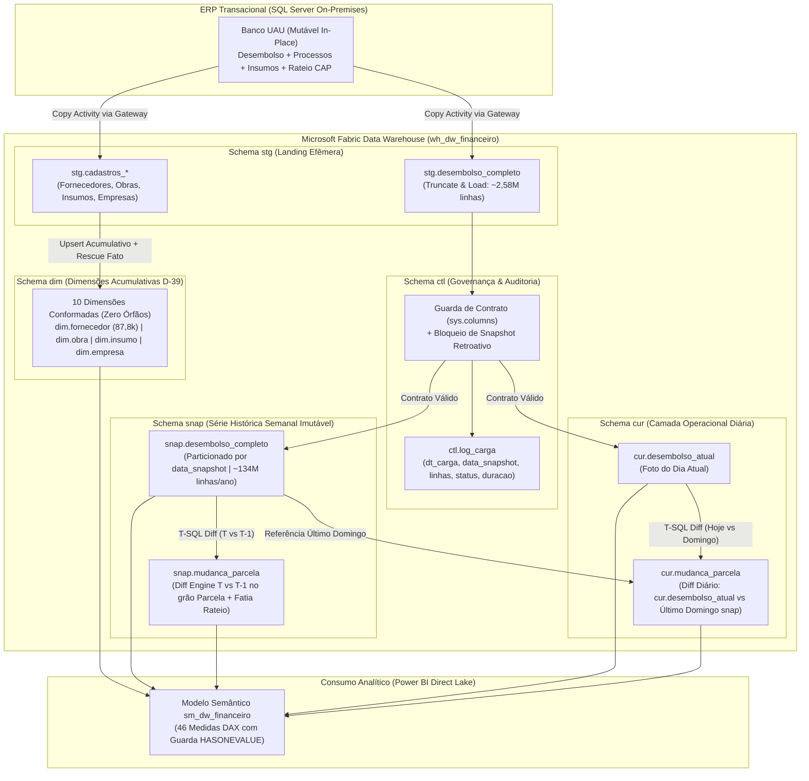

# Estudo de Caso 03 — DW Financeiro: Motor de Historização por Snapshots Semanais/Diários e Diff Engine de Parcelas/Rateios para ERPs Mutáveis

> **AVISO DE GOVERNANÇA, SEGURANÇA E DADOS SINTÉTICOS (LGPD):**  
> Este estudo de caso documenta a arquitetura real em produção do **Data Warehouse Financeiro (`wh_dw_financeiro`)** em **Microsoft Fabric Data Warehouse (T-SQL)** e **Direct Lake (`sm_dw_financeiro`)**.  
> **Todos os dados, identificadores de empresas/SPEs, códigos de obras, fornecedores, insumos e schemas executáveis neste repositório são 100% sintéticos (`seed=42`)**, gerados deterministicamente para demonstrar o funcionamento dos motores de snapshot, guarda de contrato, dimensões acumulativas e *Diff Engine* sem qualquer exposição de dados corporativos ou informações pessoais (PII).

---

## 1. Contexto e Problema de Negócio

Em operações de urbanismo, loteamentos e incorporação imobiliária de escala nacional (~263 SPEs e mais de 4.200 obras monitoradas), o fluxo de desembolso de obras e contas a pagar é gerido no ERP transacional (SQL Server). A Controladoria e a Diretoria de Operações precisavam responder com precisão matemática e rastreabilidade a uma pergunta aparentemente simples, mas impossível de ser respondida diretamente no banco transacional:

> *"O que mudou na carteira de desembolsos de obras entre o fechamento do domingo $T-1$ e o domingo $T$ — ou entre ontem e hoje — no nível de cada parcela e fatia de rateio contábil?"*

No ERP de origem, as tabelas operacionais de desembolso, processos de pagamento e composição de insumos sofrem **mutação *in-place* (sobrescrita destrutiva sem log nativo de auditoria temporal)**:
- Uma parcela a pagar pode ter seu **valor renegociado** ou corrigido;
- O **vencimento** pode ser prorrogado administrativamente;
- O **status** transita de `Aberto` para `Pago`, `Cancelado` ou `Excluído`;
- Parcelas inteiras são **excluídas fisicamente** (ou desdobradas em novas parcelas) quando um processo de compra é reprogramado;
- O **rateio por centro de custo / insumo (`CAP`, `insumo_cod`, `obra_cod`)** pode ser reclassificado entre uma semana e outra sem deixar rastro na tabela transacional.

Sem um motor de historização contínua e comparação diferencial (*Diff Engine*), qualquer consulta feita na segunda-feira sobre a semana anterior refletia o estado já modificado, inviabilizando auditorias de variação de caixa, explicação de desvios de orçamento de obra e reconciliação de relatórios executivos emitidos em datas distintas.

---

## 2. Desafio Técnico e Anomalias da Fonte

A construção do `wh_dw_financeiro` no Microsoft Fabric Data Warehouse exigiu superar desafios de volumetria, semântica temporal e **5 armadilhas técnicas reais** descobertas e documentadas durante a engenharia reversa e implantação (`D-01` a `D-41`):

### 2.1. Volumetria e Escala da Série Histórica
- Cada fotografia completa da query consolidada de desembolso (`desembolso_completo_v2_producao.sql`) captura **2.583.883 linhas por foto** (~52 colunas por registro, no grão de parcela $\times$ item $\times$ fatia de rateio de planejamento).
- Em regime de snapshots semanais (52 fotos/ano), o volume acumulado atinge **~134,3 milhões de linhas/ano**, além da fotografia operacional diária (`cur.desembolso_atual`).
- Comparar $2,58\text{M} \times 2,58\text{M}$ linhas a cada consulta no Power BI (via DAX em tempo de execução) causaria explosão de memória e lentidão severa. O diferencial precisava ser **pré-materializado no Warehouse** (`snap.mudanca_parcela` e `cur.mudanca_parcela`) contendo **apenas os registros que sofreram mutação**.

### 2.2. A Diferença Semântica Crítica: `data_snapshot` vs. `dt_carga`
Um dos pilares arquiteturais mais importantes do projeto é a separação estrita entre dois conceitos temporais frequentemente confundidos em pipelines de dados:

| Coluna / Parâmetro | Natureza Semântica | Definição Exata | Regra de Negócio e Comportamento |
| :--- | :--- | :--- | :--- |
| **`data_snapshot`** (`DATE`) | **Etiqueta Lógica da Foto** (*"De quando é esta foto na série histórica?"*) | Data de referência contábil/analítica da fotografia (ex.: sempre o domingo da semana, como `2026-10-04`, `2026-10-11`, `2026-10-18`). | Chave de partição lógica da série histórica (`snap.desembolso_completo`). Se a pipeline de domingo falhar às 08:00 e for reexecutada na segunda-feira com `data_snapshot = '2026-10-18'`, ela substitui atomicamente aquela etiqueta sem duplicar a semana. |
| **`dt_carga`** (`DATETIME2`) | **Instante Físico da Extração** (*"Quando o SQL Server foi efetivamente lido?"*) | Carimbo físico exato (`SYSDATETIME()`) do momento em que a extração começou no banco de origem. | Auditoria operacional e rastreabilidade em `ctl.log_carga`. |

> [!CAUTION]
> **Por que rodar datas passadas (`data_snapshot` retroativa) contamina a série histórica:**  
> Como o ERP de origem **sobrescreve o estado *in-place* e não possui máquina do tempo nativa**, a query de origem retorna **sempre o estado do ERP no instante físico em que roda (`dt_carga`)**. Se um engenheiro tentar "preencher um buraco" de 3 semanas atrás executando a pipeline hoje com `data_snapshot = '2026-09-27'`, o motor gravará o **estado de hoje** rotulado falsamente como se fosse de 27 de setembro — destruindo a veracidade histórica e zerando artificialmente o *diff* entre semanas. Por isso, o motor implementa **bloqueio de contaminação retroativa**: uma `data_snapshot` anterior ao último snapshot já consolidado na série é recusada (salvo flag explícita de reprocessamento do próprio snapshot mais recente).

### 2.3. As 5 Armadilhas Reais Documentadas em Produção

1. **Armadilha 1 — Collation Case-Insensitive UTF-8 no Fabric Data Warehouse:**
   - Por padrão, workspaces do Microsoft Fabric utilizam collation `Latin1_General_100_BIN2_UTF8` (case-sensitive). Porém, scripts T-SQL oriundos do SQL Server on-premises (`SQL_Latin1_General_CP1_CI_AS`) e comparações de textos de status/categorias falhavam silenciosamente quando havia variação de caixa (`'Aberto'` vs `'ABERTO'`).
   - **Solução (`D-04`):** Criação explícita do Data Warehouse com collation `Latin1_General_100_CI_AS_KS_WS_SC_UTF8` e normalização canônica (`UPPER(TRIM(...))`) nas chaves textuais e domínios de status.

2. **Armadilha 2 — `VARCHAR(N)` Conta Bytes (não Caracteres) em UTF-8:**
   - No Fabric Data Warehouse (UTF-8 nativo), `VARCHAR(10)` aloca **10 bytes**, e não 10 caracteres Unicode. Caracteres acentuados do português (`Á`, `Ç`, `Ã`, `É`, `Õ`) ocupam **2 bytes cada** em UTF-8 (e símbolos especiais como `–` ocupam 3 bytes). Colunas dimensionadas no limite exato do SQL Server legado (`CP1252`, 1 byte/caractere) estouravam com erro de truncamento (`String or binary data would be truncated`) ao ingerir descrições com acentos.
   - **Solução (`D-09`):** Dimensionamento de colunas `VARCHAR` com margem de segurança UTF-8 ($\ge 2\times$ o tamanho legado `CP1252`, ou mínimo `VARCHAR(100)` para códigos/siglas e `VARCHAR(400+)` para descrições).

3. **Armadilha 3 — Medida DAX Sem Guarda de Snapshot Inflando Valores em 52x:**
   - Na tabela `snap.desembolso_completo`, cada parcela repete sua aparição a cada domingo em que permanece na carteira. Uma medida ingênua `Total Desembolso = SUM(desembolso_completo[valor_parcela])` sem filtro de `data_snapshot` soma todas as 52 fotos do ano ao mesmo tempo, **inflando os valores financeiros em $52\times$** quando o usuário remove o filtro de data ou coloca um gráfico sem contexto de foto única.
   - **Solução (`D-21`):** Todas as 46 medidas DAX do modelo `sm_dw_financeiro` implementam **Guarda de Snapshot Obrigatória** (`HASONEVALUE(snap_desembolso[data_snapshot])` ou fixação automática em `MAX(snap_desembolso[data_snapshot])`), garantindo que agregações financeiras nunca somem múltiplas fotografias simultaneamente.

4. **Armadilha 4 — Fuso Horário UTC vs. `America/Sao_Paulo` no `TriggerTime` do Pipeline:**
   - No Microsoft Fabric Data Factory, a variável de sistema `@pipeline().TriggerTime` retorna sempre o horário em **UTC**. Uma execução agendada para sábado às 22:00 BRT (ou domingo às 00:30 BRT em janelas de manutenção) pode cruzar a fronteira de dia em UTC (`+03:00`), gerando uma `data_snapshot` deslocada em $+1$ dia (segunda-feira em vez de domingo).
   - **Solução (`D-14`):** Conversão explícita de fuso horário via expressão `@formatDateTime(convertTimeZone(pipeline().TriggerTime, 'UTC', 'E. South America Standard Time'), 'yyyy-MM-dd')` combinada com validação na Stored Procedure.

5. **Armadilha 5 — `SELECT *` Silencioso vs. Guarda de Contrato em `sys.columns`:**
   - Alterações na query de origem ou views do ERP poderiam adicionar, remover ou reordenar colunas na tabela de staging (`stg.desembolso_completo`). Um `INSERT INTO snap SELECT * FROM stg` falharia de forma obscura ou deslocaria colunas compatíveis em tipo.
   - **Solução (`D-11`):** Antes de executar qualquer promoção de `stg` para `snap` ou `cur`, uma **Guarda de Contrato de Colunas** inspeciona `sys.columns` da tabela `stg`, verificando a contagem exata e o conjunto nominal de colunas obrigatórias do contrato (`29+` colunas nucleares + colunas de fatia de rateio), abortando a transação antes de tocar nas camadas analíticas caso haja *schema drift*.

---

## 3. Arquitetura da Solução (Diagrama Ponta a Ponta)

O `wh_dw_financeiro` é organizado em **5 schemas especializados** (`ctl`, `stg`, `snap`, `cur`, `dim`), alimentados por dois fluxos complementares:
1. **Fluxo Semanal (`pl_dw_financeiro_snapshot_semanal` — Domingos 08:00 BRT):** Congela a fotografia oficial da semana em `snap.desembolso_completo` e calcula o diff semanal `snap.mudanca_parcela` ($T$ vs $T-1$).
2. **Fluxo Diário (`pl_dw_financeiro_diario` — Seg a Sáb):** Atualiza a visão operacional corrente em `cur.desembolso_atual`, sincroniza as dimensões acumulativas `dim.*` e recalcula o diff intra-semanal `cur.mudanca_parcela` (`cur` vs último domingo `snap`).



---

## 4. Decisões Técnicas e Trade-offs

| Decisão Arquitetural | Opção Escolhida | Alternativa Descartada | Justificativa Técnica e Trade-off |
| :--- | :--- | :--- | :--- |
| **Estratégia de Historização** | **Snapshots Periódicos Completos (`snap.desembolso_completo`) + Tabela de Diff Pré-Calculada (`mudanca_parcela`)** | SCD Tipo 2 tradicional linha a linha apenas na tabela principal | Em um ERP onde 2,58M de linhas sofrem rateios compostos e deleções físicas sem *soft-delete*, reconstruir o saldo exato de uma data arbitrária via `BETWEEN dt_inicio AND dt_fim` em SCD2 degrada drasticamente em Direct Lake. O snapshot semanal permite leitura colunar instantânea por `data_snapshot`, enquanto `mudanca_parcela` isola apenas os deltas (<2% das linhas/semana). |
| **Grão do Motor de Diff (`D-35` / `D-37`)** | **Duplo Grão: `parcela_id` (`empresa\|obra\|processo\|parcela`) + `fatia_rateio_id` (`parcela_id\|item\|cap\|insumo`)** | Comparação apenas pelo cabeçalho do processo de pagamento | Um processo pode manter o mesmo valor total, mas ter suas parcelas postergadas ou seu rateio de insumos (`CAP`/`insumo_cod`) alterado entre obras/etapas. O grão de fatia de rateio detecta reclassificações contábeis invisíveis no nível macro. |
| **Publicação Idempotente de Snapshot** | **`DELETE WHERE data_snapshot = @dt` + `INSERT` dentro de transação explícita (`BEGIN TRAN / COMMIT`)** | `APPEND` cego sem limpeza prévia da etiqueta | Garante que reexecuções de recuperação no mesmo dia (ou reprocessamentos forçados da última etiqueta) produzam **exatamente 1 fotografia por `data_snapshot`**, eliminando duplicidade silenciosa. |
| **Gestão de Dimensões (`D-39`)** | **Dimensões Acumulativas com Resgate de Órfãos (`atualizar_dimensoes_cadastro`)** | `TRUNCATE + INSERT` diário das tabelas de cadastro | Fornecedores ou insumos antigos presentes em snapshots passados podem ser inativados ou excluídos na origem, gerando chaves `(Em Branco)` no Power BI. A estratégia acumulativa faz *upsert* dos cadastros novos, preserva todos os códigos históricos já vistos e injeta automaticamente códigos presentes nas tabelas fato que não vieram no cadastro (`Rescue Member`). |

---

## 5. Implementação Demonstrativa (Estrutura do Projeto e Código Executável)

Para permitir que avaliadores executem e verifiquem todas as garantias de engenharia localmente em segundos — sem depender de uma capacidade Microsoft Fabric ativa ou banco SQL Server corporativo —, este repositório contém uma **implementação de referência 100% funcional em Python + SQLite/SQL** (`src/warehouse_snapshot_engine.py`).

### Estrutura de Diretórios

```text
projeto-03-dw-snapshots-diff/
├── README.md                          # Documentação arquitetural completa (este documento)
├── requirements.txt                   # Dependências leves (pytest, pyyaml)
├── config.example.yaml                # Exemplo de parametrização da pipeline e contrato
├── run_demo.py                        # Simulação de 3 domingos + carga diária cur + teste de idempotência
├── examples/
│   └── sample_output.json             # Evidência estruturada gerada pelo run_demo.py
├── src/
│   ├── __init__.py
│   └── warehouse_snapshot_engine.py   # Motor completo: Guarda de Contrato, Snapshots, Cur, Dim D-39 e Diff Engine
└── tests/
    └── test_dw_snapshots.py           # Suíte pytest validando todas as regras e armadilhas
```

### Destaques do Motor (`src/warehouse_snapshot_engine.py`)

1. **`verificar_contrato_colunas(conn_or_cols, colunas_esperadas)`:**  
   Valida o contrato estrutural da staging antes da carga. Se qualquer coluna obrigatória estiver ausente, extra ou com nome divergente, levanta `ContractViolationError` e registra falha em `ctl_log_carga` sem corromper `snap` ou `cur`.
2. **`publicar_snapshot_semanal(conn, registros_stg, data_snapshot, dt_carga, permitir_reprocessamento_ultimo=True)`:**  
   - Verifica se `data_snapshot` viola a cronologia da série (bloqueia datas passadas anteriores ao `MAX(data_snapshot)` para impedir contaminação retroativa do histórico com o estado atual do ERP);
   - Executa substituição atômica (`DELETE FROM snap_desembolso_completo WHERE data_snapshot = ?` + `INSERT`) garantindo **idempotência absoluta**;
   - Registra telemetria detalhada em `ctl_log_carga`.
3. **`atualizar_dimensoes_cadastro(conn, cadastros_origem)` (`D-39`):**  
   - Atualiza atributos de fornecedores, obras e insumos existentes e insere novos;
   - **Nunca apaga códigos históricos** que saíram do cadastro ativo do ERP;
   - Varre `snap_desembolso_completo` e `cur_desembolso_atual` para resgatar qualquer código referenciado no movimento financeiro que não conste no cadastro, garantindo **zero órfãos (`0` chaves sem dimensão)**.
4. **`calcular_mudanca_parcela(conn, modo="snap", data_snapshot_atual=None)`:**  
   - Compara a fotografia $T$ contra $T-1$ (modo `snap`) ou `cur_desembolso_atual` contra o último domingo consolidado (modo `cur`);
   - Classifica deterministicamente cada mutação em:
     - `INCLUIDA`: Nova parcela/fatia surgida na carteira;
     - `EXCLUIDA`: Parcela/fatia que existia na foto anterior e desapareceu fisicamente do ERP;
     - `STATUS_ALTERADO`: Mudança de situação (ex.: `ABERTO` $\rightarrow$ `PAGO` ou `CANCELADO`);
     - `VALOR_ALTERADO`: Renegociação ou reajuste do valor da fatia (`delta_valor = valor_atual - valor_anterior`);
     - `VENCIMENTO_ALTERADO`: Prorrogação ou antecipação da data de vencimento (`dias_deslocamento_vencimento`);
     - `RECLASSIFICADA_RATEIO`: Alteração de `cap_cod` ou `insumo_cod` mantendo a mesma chave de parcela/fatia;
   - Emite **exclusivamente as linhas com mutação**, preservando lado a lado o estado anterior e o estado atual.

---

## 6. Qualidade, Confiabilidade e Testes Automatizados

A suíte automatizada em [`tests/test_dw_snapshots.py`](file:///g:/Meu%20Drive/Portif%C3%B3lio/portfolio-workspace/case-studies/projeto-03-dw-snapshots-diff/tests/test_dw_snapshots.py) valida rigorosamente os mecanismos de defesa do Data Warehouse:

- **`test_guarda_contrato_colunas_bloqueia_schema_drift`**: Comprova que a remoção, adição não autorizada ou renomeação de coluna na staging dispara `ContractViolationError` e impede a publicação.
- **`test_idempotencia_dupla_execucao_mesmo_snapshot`**: Executa `publicar_snapshot_semanal` duas vezes seguidas para a mesma `data_snapshot` (`2026-10-18`) e verifica que a contagem de fotos e linhas permanece exata (sem duplicação) e que o log em `ctl_log_carga` registra a substituição idempotente.
- **`test_bloqueio_contaminacao_retroativa_snapshot_passado`**: Tenta publicar uma `data_snapshot` (`2026-10-04`) anterior ao último snapshot já fechado (`2026-10-18`) e comprova que o motor levanta `RetroactiveSnapshotError`, protegendo a série histórica.
- **`test_motor_diff_detecta_todos_6_tipos_mutacao`**: Verifica a detecção exata e simultânea de parcelas `INCLUIDA`, `EXCLUIDA`, `VALOR_ALTERADO`, `VENCIMENTO_ALTERADO`, `STATUS_ALTERADO` e `RECLASSIFICADA_RATEIO`, além de confirmar que parcelas inalteradas **não** poluem a tabela `mudanca_parcela`.
- **`test_dimensoes_acumulativas_zero_orfaos_d39`**: Simula a exclusão de um fornecedor antigo no cadastro do ERP e a entrada de uma parcela referenciando um insumo ainda não cadastrado, comprovando **zero órfãos** (`LEFT JOIN ... WHERE dim.cod IS NULL == 0`) em toda a série histórica.
- **`test_guarda_dax_emulada_evita_inflacao_multi_snapshot`**: Demonstra matematicamente a Armadilha 3 (soma sem filtro de snapshot inflando em $N\times$ vs. consulta com guarda de snapshot único).

### Como Executar Localmente

```bash
# 1. Executar a demonstração completa (3 domingos + carga diária cur + geração de sample_output.json)
python run_demo.py

# 2. Executar a suíte de testes automatizados
pytest tests/ -v
```

---

## 7. Resultados Comprovados e Métricas de Engenharia

| Indicador / Métrica de Engenharia | Resultado em Produção (`wh_dw_financeiro`) | Resultado na Demo Executável (`run_demo.py`) |
| :--- | :--- | :--- |
| **Volumetria por Fotografia (`snap`)** | **2.583.883 linhas / domingo** (~134,3M linhas/ano) | 3 fotografias semanais + 1 camada `cur` diária |
| **Dimensões Conformadas sem Órfãos (`D-39`)** | **10 dimensões** (ex.: `87.876` fornecedores, **0 órfãos**) | 3 dimensões auditadas com **0 órfãos** (mesmo após exclusão na origem) |
| **Redução de Volume na Consulta de Variação (`mudanca_parcela`)** | Filtra **< 2%** do volume total (apenas deltas reais entre fotos) | Emite exatamente os **6 deltas** alterados, omitindo parcelas estáticas |
| **Idempotência de Reexecução (`data_snapshot`)** | **100%** (substituição atômica transacional por etiqueta) | Validada com dupla execução do Domingo 3 mantendo 1 única foto por data |
| **Medidas Auditadas no Modelo Semântico (`sm_dw_financeiro`)** | **46 medidas DAX** protegidas contra inflação multi-snapshot | Simulação e teste automatizado de guarda de snapshot |

---

## 8. Lições Aprendidas e Evolução

1. **Em ERPs sem CDC/Temporal Tables nativo, o Data Warehouse é a própria memória institucional:** Depender apenas do estado atual do banco transacional torna impossível explicar variações de fluxo de caixa passadas. A separação clara entre `data_snapshot` (etiqueta contábil da foto) e `dt_carga` (instante físico da leitura) evitou corrupção silenciosa da série histórica em reprocessamentos.
2. **Materializar o *Diff* em SQL/T-SQL supera cálculos dinâmicos na camada de visualização:** Pré-calcular `snap.mudanca_parcela` e `cur.mudanca_parcela` no final da Stored Procedure de carga transformou uma comparação pesada de milhões de linhas em uma leitura direta e instantânea no Power BI Direct Lake.
3. **Dimensões de Data Warehouse não podem ser espelhos efêmeros do cadastro operacional:** A adoção de dimensões acumulativas com resgate automático de membros da tabela fato (`D-39`) eliminou definitivamente o surgimento de linhas `(Em Branco)` nos relatórios da Controladoria quando fornecedores ou insumos antigos eram desativados no ERP.
