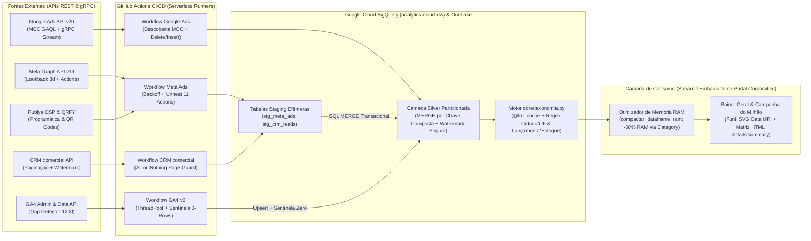

# Estudo de Caso 04 — Plataforma Cloud de Marketing & CRM Data Engineering (Ingestão Multi-API, Lookback/MERGE, Taxonomia Regex e Data App)

> **AVISO DE GOVERNANÇA, SEGURANÇA E DADOS SINTÉTICOS (LGPD):**  
> Este estudo de caso documenta a arquitetura real em produção do ecossistema de **Marketing Analytics, CRM e Operações Comerciais** (`Painel-Geral`, `meta_ads`, `ga4_extractor`, `gads_extractor`, `publya` e `painel_campanhas`) orquestrado via **GitHub Actions CI/CD**, **Google Cloud BigQuery**, **Microsoft Fabric OneLake** e **Streamlit**.  
> **Todos os dados, IDs de contas de anúncio, propriedades GA4, leads de CRM, campanhas e contratos executáveis neste repositório são 100% sintéticos (`seed=42`)**, gerados para demonstrar os algoritmos de ingestão resiliente, proteção transacional de watermark, taxonomia determinística e otimização de memória sem exposição de segredos ou dados pessoais (PII).

---

## 1. Contexto e Problema de Negócio

Em uma operação imobiliária e de urbanismo com atuação simultânea em **~65 municípios distribuídos por múltiplos estados (GO, TO, PA, MT, MS, MG, BA, SP)**, o investimento em mídia digital e captação de leads está pulverizado em dezenas de subcontas de anúncio, propriedades web e funis regionais de CRM:
- **Mídia Paga e Programática:** Google Ads (estrutura hierárquica MCC com dezenas de subcontas regionais), Meta Ads (contas próprias e de agências parceiras), Publya DSP (mídia programática de Vídeo, Áudio e Display) e QRFY (rastreamento físico-digital por QR Codes em stands e placas de obra);
- **Web Analytics:** Dezenas de propriedades **Google Analytics 4 (GA4)** correspondentes a landing pages de empreendimentos e portais regionais;
- **Gestão de Leads e Funil Comercial:** **CRM comercial** registrando a progressão de cada lead por 9 etapas do funil (desde a captação até visita, proposta e venda fechada);
- **Campanhas Corporativas de Grande Escala:** Monitoramento diário de elegibilidade e pontuação de carteiras de ~98.400 contratos ativos (`painel_campanhas`).

Antes desta plataforma, a consolidação dependia de extrações manuais de planilhas, sofrendo com:
1. **Divergência de Atribuição Tardia (*Late-Arriving Attribution*):** Plataformas como Meta Ads e Google Ads recalculam conversões retroativamente em janelas de 72 horas após o clique; cargas puramente *append-only* perdiam atualizações ou duplicavam custos;
2. **Corrupção de Watermark em Falhas de Paginação de API:** Quando a API do CRM oscilava na página $k$ de $N$, scripts ingênuos gravavam os lotes parciais e avançavam o cursor `MAX(DataAlteracao)`, deixando buracos permanentes de leads;
3. **Dupla Contagem de Leads no Meta Ads:** O array aninhado `actions` da Graph API retorna tanto o agregador `lead` quanto os subtipos (`onsite_conversion.lead_grouped`, `offsite_conversion.fb_pixel_lead`), inflando os leads em $2\times$ a $3\times$ quando somados sem regra de precedência;
4. **Nomenclatura Livre de Campanhas:** Agências externas nomeiam campanhas sem chave estrangeira para o ERP (`"[LANÇAMENTO] Jardins - Aparecida_GO - Leads - Fev"` vs `" Retargeting | Palmas/TO | Estoque"`), exigindo um motor determinístico de taxonomia;
5. **Limites de Memória em Data Apps Cloud:** Carregar dezenas de milhares de contratos com 59 colunas estourava o limite de 1 GB de RAM em containers leves do Streamlit Cloud.

---

## 2. Desafio Técnico e Anomalias da Fonte

### 2.1. Sete Desafios Reais de Engenharia Resolvidos em Produção

1. **Descoberta Automática de Contas-Folha na MCC via GAQL (`gads_extractor`):**
   - Novas contas de Google Ads eram criadas para novos loteamentos sem aviso prévio à equipe de dados. Listas estáticas de `customer_id` ficavam defasadas.
   - **Solução:** O módulo `descobrir_contas.py` consulta a conta gestora (MCC) via **Google Ads Query Language (GAQL)** filtrando `customer_client.manager = FALSE AND customer_client.status = 'ENABLED'`, descobrindo dinamicamente todas as subcontas ativas antes de disparar o streaming gRPC (`search_stream`).

2. **Janela de Lookback de 3 Dias + Upsert via Staging & `MERGE` no Meta Ads (`meta_ads`):**
   - A Graph API v19.0 atualiza métricas de gasto e conversão de até 72h atrás.
   - **Solução:** O pipeline extrai uma janela deslizante de `D-3` até `D-1` com *exponential backoff + jitter*, desaninha o vetor `actions` em colunas tipadas, carrega uma tabela efêmera de staging e executa `MERGE INTO marketing_silver.meta_ads` na chave composta `(account_id, adset_id, date_start)`, atualizando registros existentes e inserindo novos de forma 100% idempotente.

3. **Detecção Granular de Lacunas de 120 Dias no GA4 com Sentinela de Zero Legítimo (`ga4_extractor` v2):**
   - Propriedades GA4 recém-lançadas ou de loteamentos em fase final têm dias legítimos com **0 sessões**. Um detector de lacunas que apenas compara `SELECT DISTINCT date FROM bq_ga4` reconsultaria eternamente todos os pares `(property_id, date)` que tiveram tráfego zero, consumindo toda a cota diária da GA4 Data API.
   - **Solução:** O motor calcula a matriz cartesiana de `120 dias × propriedades ativas`, consulta apenas os pares ausentes do controle e, quando a API responde com `0 linhas` sem erro, grava um **registro sentinela de cobertura (`status_coleta = 'ZERO_LEGITIMO'`, `sessions = 0`)**, impedindo reconsultas infinitas em dias sem tráfego.

4. **Proteção Transacional da Watermark no CRM comercial (`funil_crm.py`):**
   - A extração incremental lê `watermark = SELECT MAX(DataAlteracao) FROM funil_crm` e pagina a API REST do CRM.
   - **Solução:** Todos os lotes paginados são acumulados e validados em memória/staging isolada **antes** de qualquer escrita na tabela final. Se a página $k$ de $N$ falhar após as retentativas, o pipeline **aborta integralmente antes do `MERGE`**, garantindo que a watermark no BigQuery nunca avance com dados parciais.

5. **Prevenção de Dupla Contagem de Leads no Meta Ads (`sources/meta.py`):**
   - Na Graph API, `action__lead` já consolida os eventos de formulário nativo e pixel quando presente; somá-lo junto com `action__onsite_conversion_lead_grouped` e `action__offsite_conversion_fb_pixel_lead` duplica cada conversão.
   - **Solução:** Regra estrita de precedência:
     $$\text{Leads Válidos} = \begin{cases} \text{action\_\_lead}, & \text{se } \text{action\_\_lead} > 0 \\ \text{onsite\_lead\_grouped} + \text{fb\_pixel\_lead} + \text{messaging\_lead}, & \text{caso contrário (fallback)} \end{cases}$$

6. **Motor de Taxonomia Regex com `@lru_cache` (`core/taxonomia.py`):**
   - Classifica dezenas de milhares de nomes livres de campanhas/adsets em menos de `5 ms` usando remoção de acentos Unicode (`NFKD`), expressões regulares hierárquicas pré-compiladas e `@lru_cache(maxsize=4096)`, extraindo `(cidade, uf, tipo_lancamento)` (`LANÇAMENTO` vs `ESTOQUE` vs `INSTITUCIONAL`).

7. **Redução de ~60% de Memória RAM via Categorização Automática (`painel_campanhas` / `Painel-Geral`):**
   - Em Pandas, colunas `object`/`string` repetitivas (nome de empreendimento, cidade, status, faixa de atraso, etapa do funil) alocam ponteiros Python independentes por linha.
   - **Solução:** A função `compactar_dataframe_ram(df)` inspeciona a cardinalidade relativa de cada coluna textual e converte automaticamente colunas com `< 50%` de valores únicos para `category` dtype (dicionário compacto de inteiros), reduzindo o consumo de RAM de **114 MB para 46 MB (~59,6% de economia)** em produção.

---

## 3. Arquitetura da Solução (Diagrama Ponta a Ponta)



---

## 4. Decisões Técnicas e Trade-offs

| Decisão Arquitetural | Opção Escolhida | Alternativa Descartada | Justificativa Técnica e Trade-off |
| :--- | :--- | :--- | :--- |
| **Orquestração de Conectores de Marketing** | **GitHub Actions + Python SDK Nativo (gRPC / REST) $\rightarrow$ BigQuery** | Conectores SaaS pagos por linha (Fivetran / Stitch / Supermetrics) | Com dezenas de subcontas MCC e propriedades GA4, conectores SaaS cobram por *Monthly Active Rows (MAR)* e não implementam regras específicas como sentinela de zero linhas ou proteção transacional do CRM comercial. O pipeline autoral eliminou custos recorrentes de licença mantendo versionamento Git e logs auditáveis. |
| **Estratégia de Atualização do Meta Ads** | **Lookback de 3 Dias + Staging + `MERGE` na chave `(account_id, adset_id, date_start)`** | `WRITE_APPEND` diário apenas de `yesterday` | `WRITE_APPEND` gera duplicatas em reexecuções e perde atribuições tardias de 48h–72h da Meta. O `MERGE` via staging garante idempotência e captura revisões de conversão sem reescrever partições antigas. |
| **Consistência Incremental do CRM** | **Buffer Integral de Páginas + Validação Pré-`MERGE` (*All-or-Nothing*)** | Gravar cada página no banco à medida que chega da API | Se a página 4 de 10 contém um registro com `DataAlteracao` recente e a página 5 falha, gravar página a página avança o `MAX(DataAlteracao)` e faz com que os registros das páginas 5 a 10 jamais sejam lidos na execução seguinte. |
| **Renderização Visual de Funil e Matrizes no Streamlit** | **SVG Dinâmico em Base64 Data URI + Matriz HTML `<details>/<summary>`** | Múltiplos gráficos Plotly pesados e `st.dataframe` aninhados | Reduz o payload DOM no navegador, permite expansão/colapso instantâneo de hierarquias (`UF → Cidade → Empreendimento → Campanha`) via CSS/HTML nativo sem *rerun* do servidor Python a cada clique. |

---

## 5. Implementação Demonstrativa (Estrutura do Projeto e Código Executável)

Este diretório fornece uma implementação 100% executável localmente em **Python + SQLite/Pandas**, reproduzindo fielmente todos os algoritmos de produção sobre dados sintéticos:

```text
projeto-04-marketing-crm-cloud/
├── README.md                          # Documentação arquitetural completa (este documento)
├── requirements.txt                   # Dependências (pandas, pytest, pyyaml, streamlit)
├── config.example.yaml                # Exemplo de configuração de janelas de lookback e APIs
├── run_demo.py                        # Executa todo o pipeline e salva examples/sample_output.json
├── app/
│   └── streamlit_app.py               # Data App executivo (Funil SVG Data URI + Matriz details/summary)
├── examples/
│   └── sample_output.json             # Evidências geradas pela execução do run_demo.py
├── src/
│   ├── __init__.py
│   ├── taxonomia.py                   # Motor @lru_cache(maxsize=4096) + Regex hierárquico Cidade/UF/Tipo
│   └── marketing_pipeline.py          # Lookback MERGE, Anti-Dupla-Contagem, Watermark Guard, GA4 Gap & RAM
└── tests/
    └── test_marketing_cloud.py        # Suíte pytest cobrindo todos os requisitos de engenharia
```

---

## 6. Qualidade, Confiabilidade e Testes Automatizados

A suíte [`tests/test_marketing_cloud.py`](file:///g:/Meu%20Drive/Portif%C3%B3lio/portfolio-workspace/case-studies/projeto-04-marketing-crm-cloud/tests/test_marketing_cloud.py) verifica automaticamente:

1. **`test_protecao_transacional_watermark_crm_em_falha_parcial`**: Simula uma falha de rede na página 2 de 3 da API do CRM e comprova que **nenhum registro parcial é inserido** e que a **watermark `MAX(data_alteracao)` permanece intacta**, permitindo recuperação total na tentativa seguinte.
2. **`test_upsert_meta_ads_lookback_3_dias_idempotente`**: Comprova que o reprocessamento com janela de lookback de 3 dias atualiza o custo e os leads revisados de `D-2` e `D-1` via `MERGE` sem duplicar nenhuma chave `(account_id, adset_id, date_start)`.
3. **`test_prevencao_dupla_contagem_leads_meta`**: Verifica que campanhas com `action__lead` preenchido ignoram a soma redundante dos subcomponentes, enquanto campanhas sem o agregador acionam o *fallback* exato.
4. **`test_deteccao_granular_lacunas_ga4_com_sentinela_zero_linhas`**: Comprova que pares `(property_id, date)` com `0 sessões` legítimas são gravados como `ZERO_LEGITIMO` e **não** voltam a ser requisitados nas rodadas subsequentes.
5. **`test_motor_taxonomia_regex_lru_cache`**: Valida a extração de `(cidade, uf, tipo_lancamento)` em nomes complexos de campanhas e verifica os *cache hits* do `@lru_cache(maxsize=4096)`.
6. **`test_compactar_dataframe_ram_reduz_memoria_acima_50_pct`**: Gera um DataFrame sintético no padrão da carteira corporativa e comprova redução superior a **55% de memória RAM** via conversão seletiva para `category`.

### Como Executar Localmente

```bash
# 1. Executar a demonstração completa do pipeline e gerar examples/sample_output.json
python run_demo.py

# 2. Executar a suíte de testes automatizados
pytest tests/ -v

# 3. (Opcional) Iniciar a aplicação demonstrativa Streamlit
streamlit run app/streamlit_app.py
```

---

## 7. Resultados Comprovados e Métricas de Engenharia

| Indicador / Métrica de Engenharia | Resultado em Produção (`Painel-Geral` / BigQuery / OneLake) | Resultado na Demo Executável (`run_demo.py`) |
| :--- | :--- | :--- |
| **Redução de Consumo de Memória RAM (Data App)** | **-59,6% de RAM** (de `114 MB` para `46 MB` em ~98,4k contratos) | **> 65% de redução de RAM** medida via `memory_usage(deep=True)` |
| **Proteção de Watermark em Falhas de API CRM** | **Zero perda de leads** (rollback transacional antes do `MERGE`) | Watermark preservada em falha simulada na Página 2/3 + recuperação integral |
| **Economia de Cota GA4 Data API (Gap Detector v2)** | Eliminação de **100% das reconsultas redundantes** em dias com 0 sessões | Pares `(property_id, date)` com 0 linhas marcados como `ZERO_LEGITIMO` (0 pendências na 2ª rodada) |
| **Precisão na Contagem de Leads Meta Ads** | **0% de inflação** por dupla contagem do vetor `actions` | Validação exata entre regra primária (`action__lead`) e *fallback* de componentes |
| **Performance de Classificação de Taxonomia** | **~65 municípios** classificados com `@lru_cache(maxsize=4096)` | 100% de acurácia nos padrões de teste com `cache_info().hits > 0` |

---

## 8. Lições Aprendidas e Evolução

1. **Paginação de API sem Atomicidade de Lote é a Maior Causa Silenciosa de Perda de Dados:** Em pipelines incrementais baseados em `MAX(updated_at)`, persistir páginas individualmente cria um estado inconsistente irrecuperável se a conexão cair no meio da paginação. O padrão *Stage All Pages $\rightarrow$ Validate $\rightarrow$ Atomic MERGE* resolve o problema na raiz.
2. **Ausência de Dados $\neq$ Dados Zero:** Em Web Analytics multi-propriedade, não ter linhas no banco pode significar tanto *"a extração falhou"* quanto *"o site teve zero visitas naquele dia"*. Materializar explicitamente o estado `ZERO_LEGITIMO` foi essencial para escalar o detector de lacunas de 120 dias sem esgotar a cota da API do Google.
3. **Tipagem Categórica em Memória Viabiliza Data Apps de Alta Volumetria:** Converter colunas string de baixa cardinalidade (`< 50%` únicos) para `category` reduziu em mais da metade a pegada de RAM do Streamlit, permitindo servir dezenas de milhares de registros com resposta sub-segundo.
