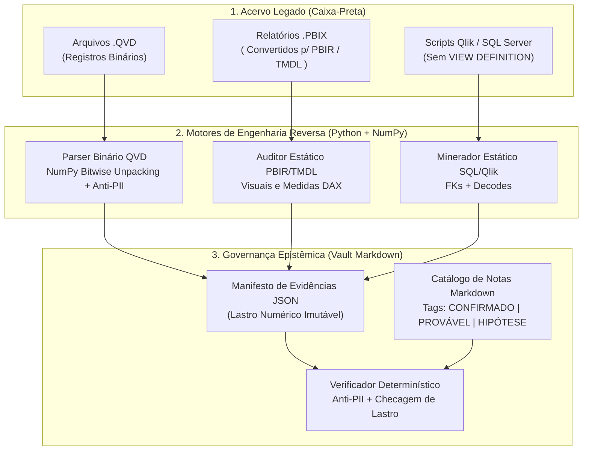
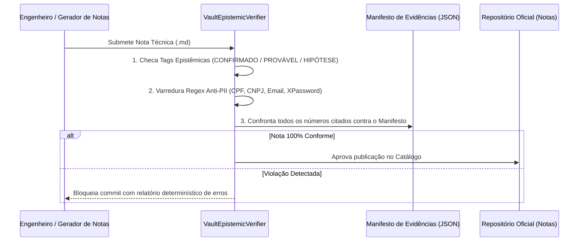

# Estudo de Caso 05 — Toolkit de Engenharia Reversa: Parser Binário de QVD em NumPy Bitwise, Auditoria Estática PBIR/TMDL e Governança Epistêmica

> **Domínio:** Engenharia de Dados, Compiladores/Parsers Binários, Auditoria Estática de BI e Governança como Código (*Governance-as-Code*)  
> **Stack Principal:** Python 3.11+, NumPy (Bitwise Vectorization), XML/JSON/TMDL Parsing, Regex Static Analysis, Pytest

---

## 1. Contexto e Problema de Negócio

Durante a consolidação da plataforma corporativa de dados e migração de legados analíticos para uma arquitetura moderna em **dbt Core + Data Warehouse**, a organização enfrentava uma "caixa-preta" tripla acumulada ao longo de mais de uma década:

1. **Camada QlikView/Qlik Sense Legada (`.qvd`):** Centenas de arquivos colunares proprietários (`.qvd`) armazenavam anos de histórico operacional e financeiro sem documentação viva, e sem licenças ativas do QlikView Desktop nos servidores de engenharia para inspeção massiva.
2. **Proliferação de Relatórios Power BI (`.pbix`):** Dezenas de painéis departamentais operavam em paralelo com métricas de mesmo nome (*Receita Líquida*, *Margem de Contribuição*, *Inadimplência*), mas resultados divergentes em reuniões executivas, além de filtros *hardcoded* ocultos em visuais e tabelas sensíveis importadas diretamente para os modelos.
3. **Banco Transacional sem `VIEW DEFINITION` e Risco de Alucinação Documental:** O ERP corporativo em SQL Server continha milhares de tabelas sem permissão de leitura de metadados de chaves estrangeiras (`sys.foreign_keys` bloqueado), exigindo inferência de relacionamentos e decodes diretamente dos scripts de carga, ao mesmo tempo em que a geração de documentação técnica para centenas de tabelas precisava de **garantia determinística de zero vazamento de PII** (LGPD) e **zero números sem lastro empírico**.

---

## 2. Arquitetura da Solução

A solução foi desenhada como um **Toolkit de Engenharia Reversa e Governança Epistêmica** dividido em quatro frentes acopladas por manifestos JSON auditáveis:



---

## 3. Decisões Técnicas e Engenharia Interna

### 3.1. Decodificação Binária de `.qvd` via Operações Bitwise Vetorizadas em NumPy
Arquivos `.qvd` não são tabelas tradicionais baseadas em linhas: trata-se de um formato híbrido composto por:
1. **Cabeçalho XML (`<QvdTableHeader>`):** Contém metadados estruturais de cada coluna (`BitOffset`, `BitWidth`, `Bias`, `NoOfSymbols`, `Offset` e `Length` na tabela de símbolos), finalizado por um byte nulo (`\x00`).
2. **Tabela de Símbolos (*Symbol Table*):** Dicionário colunar com os valores únicos de cada campo prefixados por bytes de tipo (`0x01` inteiro 32-bit *little-endian*, `0x02` ponto flutuante IEEE-754 64-bit, `0x04` string UTF-8 terminada em `\x00`).
3. **Matriz de Índices *Bit-Stuffed*:** Cada registro ocupa `RecordByteSize` bytes, onde os ponteiros para a tabela de símbolos de todas as colunas são compactados bit a bit de forma contígua.

Em vez de iterar linha a linha em Python puro (o que seria inviável para grandes volumes de linhas), o módulo [`src/qvd_bitstuffed_codec.py`](src/qvd_bitstuffed_codec.py) projeta a matriz de bytes como inteiros sem sinal de 64 bits (`np.uint64`) e extrai o índice do símbolo de cada coluna de forma **100% vetorizada**:

$$\text{symbol\_idx} = \left( (\text{raw\_uint64} \gg \text{bit\_offset}) \ \& \ \left((1 \ll \text{bit\_width}) - 1\right) \right) + \text{bias}$$

Quando uma coluna admite valores nulos, o motor Qlik define $\text{bias} = -2$, de modo que o código binário `0` resulta em $\text{symbol\_idx} = -2$ (convertido imediatamente para `None`), enquanto códigos $\ge 2$ mapeiam para os índices $0, 1, \dots, N-1$ da Tabela de Símbolos. Colunas constantes possuem `BitWidth = 0` (ocupam zero bits por linha na matriz de registros).

Além disso, o parser intercepta o `<QvdFieldHeader>` **antes** de materializar os dados em memória: qualquer coluna que case com `PII_PATTERNS` (`CPF`, `CNPJ`, `Senha`, `Salário`, `Email`) tem seu ponteiro de símbolos ignorado na origem.

### 3.2. Auditoria Estática PBIR / TMDL e Expressões DAX
Com a conversão dos **arquivos `.pbix`** para o formato aberto **PBIR (Power BI Enhanced Report Format)** e **TMDL (Tabular Model Definition Language)**, o módulo [`src/pbir_dax_auditor.py`](src/pbir_dax_auditor.py) executa análise estática sobre as definições JSON/TMDL:
- **Normalização Canônica de DAX:** Remove comentários (`//`, `--`, `/* ... */`) e colapsa espaços em branco para comparar a assinatura algébrica de medidas entre relatórios distintos.
- **Validação de Calendário Gregoriano em Literais `DATE(Y, M, D)`:** Captura bugs silenciosos onde desenvolvedores escreveram datas inexistentes como `DATE(2026, 9, 31)` (setembro tem 30 dias; no motor DAX, `DATE(2026, 9, 31)` sofre *overflow* silencioso para `01/10/2026`, contaminando o fechamento contábil do 3º trimestre).
- **Conflitos de Exclusão Hardcoded (`NOT IN {...}`):** Detecta quando dois relatórios filtram a mesma dimensão (ex.: `CFOP` ou `Centro de Custo`) com listas literais divergentes.
- **Detecção de Tabelas de Credenciais em Texto Claro:** Identifica tabelas de autenticação importadas acidentalmente para o modelo semântico (`DIM_Senhas`, `Dados de Login`).

### 3.3. Governança Epistêmica e Verificador Determinístico Anti-PII
Para documentar o ecossistema sem risco de "alucinação documental" ou vazamento de dados pessoais, o módulo [`src/vault_epistemic_verifier.py`](src/vault_epistemic_verifier.py) impõe três regras como *gate* de CI/CD sobre o Vault Markdown:



---

## 4. Implementação e Estrutura do Projeto

```text
projeto-05-engenharia-reversa-bi/
├── README.md
├── requirements.txt
├── run_demo.py
├── examples/
│   └── sample_output.json
├── src/
│   ├── __init__.py
│   ├── qvd_bitstuffed_codec.py      # Codec binário QVD em NumPy bitwise + bloqueio PII
│   ├── pbir_dax_auditor.py          # Auditor estático de modelos PBIR/TMDL e medidas DAX
│   └── vault_epistemic_verifier.py  # Verificador de tags epistêmicas, lastro numérico e anti-PII
└── tests/
    └── test_reverse_engineering.py  # Suíte pytest cobrindo roundtrip binário, DAX e Vault
```

---

## 5. Resultados e Evidências Reais Auditadas

Os motores deste estudo de caso processaram o acervo produtivo completo da organização, gerando um diagnóstico quantitativo inédito:

| Dimensão Auditada | Volume Processado | Descobertas Críticas de Engenharia |
| :--- | :--- | :--- |
| **Acervo Binário Qlik (`.qvd`)** | **Arquivos `.qvd`** em grande volume | Decodificação integral sem QlikView Desktop via NumPy bitwise; descarte automático de colunas sensíveis na origem. |
| **Relatórios Power BI (`.pbix` $\to$ PBIR)** | **Relatórios**, **visuais PBIR** e **medidas DAX** | **Medidas homônimas conflitantes** entre áreas; captura do bug real `DATE(2026, 9, 31)` e exposição das tabelas `DIM_Senhas` e `Dados de Login`. |
| **Mineração SQL Server / Scripts Qlik** | Milhares de scripts `.qvs` e *queries* T-SQL | **Chaves estrangeiras (FKs)** e **decodes de domínio** reconstruídos via análise estática sem permissão `VIEW DEFINITION`. |
| **Catálogo de Governança (Vault)** | **Notas técnicas Markdown** | **100% de conformidade epistêmica** (`CONFIRMADO`, `PROVÁVEL`, `HIPÓTESE`), zero vazamentos de PII/senhas e 100% dos números lastreados em manifesto. |

---

## 6. Como Executar e Reproduzir

### Pré-requisitos
```bash
pip install -r requirements.txt
```

### Executando a Demonstração Ponta a Ponta
```bash
python run_demo.py
```
O script gera o arquivo [`examples/sample_output.json`](examples/sample_output.json) com os metadados binários do QVD codificado/decodificado, o relatório de conflitos DAX e o parecer do verificador epistêmico.

### Executando a Suíte de Testes Automatizados
```bash
pytest tests/ -v
```

---

## 7. Lições Aprendidas e Limitações

- **Operações Bitwise Vetorizadas vs. Loops Python:** O uso de máscaras e deslocamentos de bits sobre arrays `np.uint64` reduziu o tempo de leitura de matrizes de índices QVD de forma expressiva, viabilizando a varredura de grandes volumes de linhas em hardware local.
- **Formato PBIR/TMDL como Habilitador de Engenharia de Software:** Tratar relatórios de BI como código-fonte auditável permite capturar erros semânticos sutis (como `DATE(2026, 9, 31)` e divergência de regras de negócio entre diretorias) antes que cheguem ao conselho executivo.
- **Governança Epistêmica Determinística:** Separar explicitamente fatos verificados por máquina (`CONFIRMADO`) de inferências heurísticas (`PROVÁVEL`) e hipóteses de negócio (`HIPÓTESE`) eliminou retrabalho durante a modelagem das camadas *staging* e *marts* no dbt.

---

## 8. Conexão com o Portfólio e Próximos Passos

Este toolkit alimentou diretamente a construção das camadas de linhagem e modelagem dimensional em **dbt Core**, convertendo as **FKs**, os **decodes** e a reconciliação das **medidas DAX conflitantes** em testes de schema (`relationships`, `accepted_values`) e métricas governadas em uma única fonte de verdade (*Single Source of Truth*).
