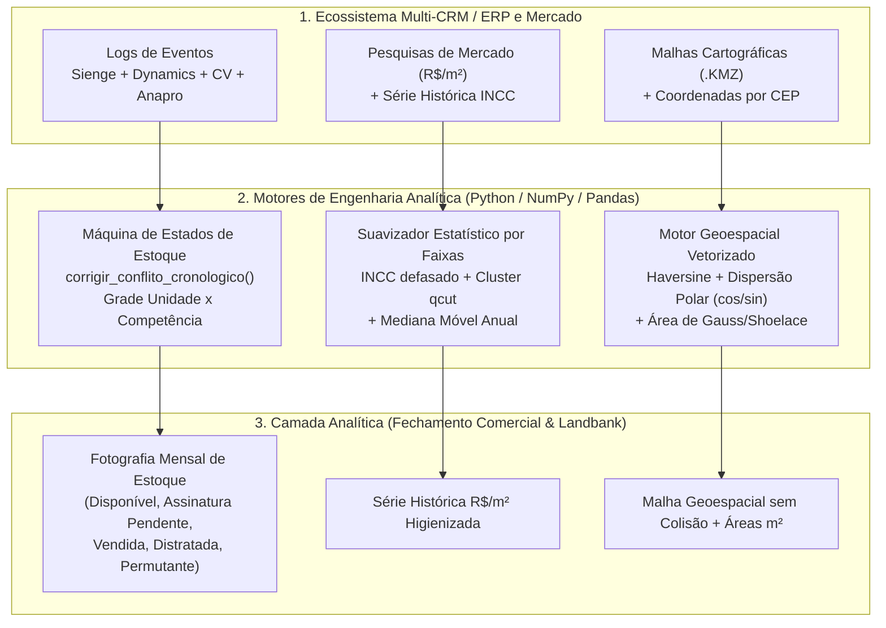
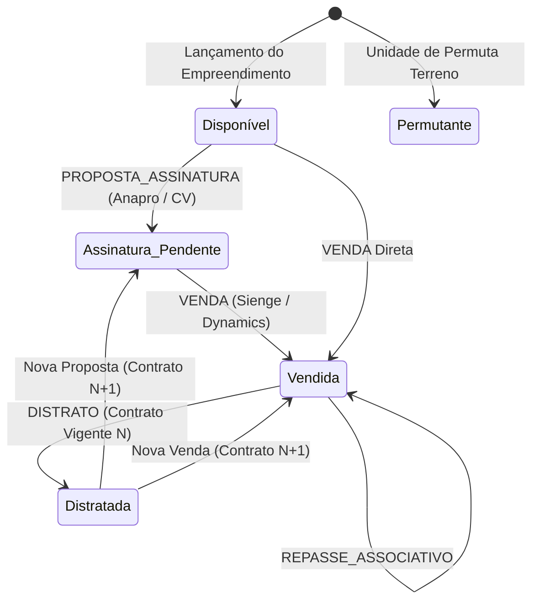

# Estudo de Caso 06 — Máquina do Tempo de Estoque Imobiliário (Multi-CRM/ERP), Suavização Estatística de Preços via INCC e Enriquecimento Geoespacial

> **Domínio:** Engenharia Analítica Imobiliária (*Real Estate Data Engineering*), Reconciliação Temporal Multi-ERP/CRM, Séries Temporais Econômicas e Inteligência Geoespacial  
> **Stack Principal:** Python 3.11+, Pandas, NumPy (Vectorized Trigonometry & Linear Algebra), Pytest

---

## 1. Contexto e Problema de Negócio

Em incorporadoras de grande porte com ciclos construtivos longos, a análise fidedigna da **Velocidade Sobre Oferta (VSO)**, da evolução de preços por $\text{m}^2$ e do posicionamento competitivo dos terrenos depende da integração de sistemas que não foram projetados para conversar entre si:

1. **Fragmentação Histórica Multi-CRM/ERP e Anomalias Cronológicas:** Ao longo de quase uma década, o ciclo de vida das unidades autônomas transitou entre **Sienge** (ERP contábil/engenharia), **Microsoft Dynamics**, **Anapro** e **Construtor de Vendas (CV)**. Como os sistemas não gravam snapshots mensais nativos do estoque e o registro contábil de um **Distrato** do contrato $N$ frequentemente é efetivado semanas **após** a unidade já ter sido revendida para um novo comprador no contrato $N+1$ no CRM comercial, uma ordenação ingênua por data de evento marcava unidades vendidas como "Distratadas" no fechamento mensal.
2. **Ruído e Outliers em Pesquisas de Mercado ($\text{R\$}/\text{m}^2$):** Pesquisas mensais de concorrência sofrem com erros de digitação, distorções pontuais de tabela promocional e variações bruscas de mix, exigindo um motor de higienização estatística ancorado na dinâmica inflacionária real da construção civil (**INCC** com defasagem contratual de $+2\text{ meses}$).
3. **Colisão Geoespacial por CEP e Polígonos de Terrenos (`.kmz`/`.kml`):** Múltiplos empreendimentos ou leads geocodificados pelo mesmo CEP colapsavam em um único ponto exato $(lat, lon)$ nos mapas analíticos, enquanto arquivos cartográficos de prospecção de terrenos (`.kmz`) precisavam de cálculo instantâneo de área plana em $\text{m}^2$ sem depender de bibliotecas GIS pesadas (GDAL/GEOS) em servidores leves.

---

## 2. Arquitetura da Solução

A arquitetura integra três motores especializados que alimentam o Data Mart Comercial e de Inteligência de Mercado:



---

## 3. Decisões Técnicas e Engenharia Interna

### 3.1. Máquina do Tempo de Estoque e Resolução de Conflitos Cronológicos ($N$ vs. $N+1$)
No módulo [`src/state_machine_estoque.py`](src/state_machine_estoque.py), a função `corrigir_conflito_cronologico()` resolve o problema clássico de dessincronia entre a esteira comercial (CRM) e a baixa contábil (ERP):



Quando o contrato $N$ sofre `DISTRATO` na data $t_{\text{distrato}}(N)$, mas já existe um contrato sucessor $M > N$ na mesma unidade cuja ativação (`VENDA` ou `PROPOSTA_ASSINATURA`) ocorreu em $t_{\text{início}}(M) \le t_{\text{distrato}}(N)$, o motor retroage a data efetiva de encerramento do contrato $N$ para $t_{\text{início}}(M) - 1\text{ dia}$ e sinaliza `conflito_cronologico_corrigido = True`. Dessa forma, a expansão da grade cartesiana $\text{Unidade} \times \text{Mês}$ preserva a integridade da venda ativa $M$.

### 3.2. Suavização Estatística de Preços/$\text{m}^2$ por Faixas com Defasagem no INCC
No módulo [`src/suavizacao_estatistica_incc.py`](src/suavizacao_estatistica_incc.py):
1. **Defasagem Contratual:** A série mensal do INCC é deslocada por uma defasagem configurável (`DateOffset`), reproduzindo a convenção de reajuste de tabelas imobiliárias.
2. **Clusterização por Quantis de Área (`qcut`):** Os empreendimentos são segmentados em clusters homogêneos de metragem (`CLUSTER_Q1`, `CLUSTER_Q2`, `CLUSTER_Q3`).
3. **Regra de Decisão por Faixas de Desvio Relativo ($\delta = \frac{|P_{\text{obs}} - M|}{M}$, com $M$ a mediana móvel anual):**
   - **Faixa 1 ($\delta \le \theta_1$):** Oscilação normal de mercado $\to$ **mantém o preço original observado** ($P_{\text{obs}}$).
   - **Faixa 2 ($\theta_1 < \delta \le \theta_2$):** Desvio moderado de coleta $\to$ **substitui pela mediana móvel anual** ($M$).
   - **Faixa 3 ($\delta > \theta_2$):** Outlier severo / erro de preenchimento $\to$ **substitui pela curva teórica do cluster corrigida pelo INCC defasado** ($P_{\text{cluster, INCC}}$).

### 3.3. Enriquecimento Geoespacial: Haversine, Dispersão Polar e Fórmula de Gauss/Shoelace
No módulo [`src/geoespacial_utils.py`](src/geoespacial_utils.py):
- **Distância Esférica de Haversine ($R = 6371.0\text{ km}$):**
  $$d = 2 R \arctan2\left(\sqrt{\sin^2\left(\frac{\Delta\phi}{2}\right) + \cos\phi_1\cos\phi_2\sin^2\left(\frac{\Delta\lambda}{2}\right)}, \sqrt{1 - a}\right)$$
- **Dispersão Polar Vetorizada em Anéis Concêntricos (`ajustar_coordenadas_duplicadas_fast`):** Separa pontos que colidem no mesmo CEP distribuindo as duplicatas ($k \ge 1$) em anéis de raio $r_k = r_{\text{base}} \lceil k / M \rceil$ metros e ângulo $\theta_k = \frac{2\pi ((k-1) \bmod M)}{M}$:
  $$\Delta\text{lat} = \frac{r_k \sin\theta_k}{111320}, \qquad \Delta\text{lon} = \frac{r_k \cos\theta_k}{111320 \cos(\text{lat}_0)}$$
- **Área de Polígonos via Fórmula de Gauss / *Shoelace*:** Projeta os vértices $(lat_i, lon_i)$ no plano tangente local em metros $(x_i, y_i)$ e calcula a área exata de terrenos `.kmz`:
  $$A = \frac{1}{2} \left| \sum_{i=0}^{n-1} (x_i y_{i+1} - x_{i+1} y_i) \right|$$

---

## 4. Implementação e Estrutura do Projeto

```text
projeto-06-maquina-estados-imobiliario/
├── README.md
├── requirements.txt
├── run_demo.py
├── examples/
│   └── sample_output.json
├── src/
│   ├── __init__.py
│   ├── state_machine_estoque.py       # Máquina do tempo de estoque + correção cronológica N vs N+1
│   ├── suavizacao_estatistica_incc.py # Suavização por faixas + INCC defasado + mediana anual
│   └── geoespacial_utils.py           # Haversine, dispersão polar vetorizada e área Shoelace
└── tests/
    └── test_maquina_estados.py        # Suíte pytest cobrindo estoque, INCC e geoespacial
```

---

## 5. Resultados e Impacto Operacional

| Indicador / Subsistema | Antes da Engenharia | Após a Implementação |
| :--- | :--- | :--- |
| **Reconciliação Histórica de Estoque** | Divergência entre relatórios comerciais (CV/Anapro) e contábeis (Sienge) devido a distratos tardios. | **100% de consistência temporal** na Fotografia Mensal de Estoque via `corrigir_conflito_cronologico()`. |
| **Séries Históricas de Preço/$\text{m}^2$** | Distorções em análises de VSO e *pricing* causadas por outliers de digitação. | **Higienização automatizada por faixas** ancorada na mediana móvel anual e na curva INCC defasada. |
| **Geoprocessamento de Mercado e Terrenos** | Sobreposição visual de dezenas de imóveis no mesmo CEP e dependência manual do Google Earth Pro para áreas. | **Zero colisões visuais** com preservação de quadra/bairro (dispersão polar de $12\text{m}$–$15\text{m}$) e extração instantânea de áreas em $\text{m}^2$. |

---

## 6. Como Executar e Reproduzir

### Pré-requisitos
```bash
pip install -r requirements.txt
```

### Executando a Demonstração Ponta a Ponta
```bash
python run_demo.py
```
O script gera o arquivo [`examples/sample_output.json`](examples/sample_output.json) contendo a Fotografia Mensal de Estoque corrigida, a tabela de preços suavizados por faixas do INCC e os cálculos geoespaciais.

### Executando a Suíte de Testes Automatizados
```bash
pytest tests/ -v
```

---

## 7. Lições Aprendidas e Limitações

- **Sistemas Transacionais Não Guardam Fotografia Temporal:** Em ERPs imobiliários, o status atual da unidade sobrescreve o passado. A única forma confiável de responder *"qual era o estoque disponível em março de 2021?"* é reconstruir a máquina de estados a partir do log imutável de eventos contratuais.
- **Ordem Contábil $\neq$ Ordem de Negócio:** Burocracias jurídicas de distrato geram timestamps contábeis posteriores à revenda comercial do imóvel. Sem vincular cada evento ao identificador único da sequência contratual ($N$ vs. $N+1$), qualquer *window function* puramente baseada em `data_evento` corrompe o estado atual.
- **Geometria Analítica Vetorizada em NumPy:** Substituir loops iterativos de jitter aleatório por dispersão polar determinística ($\cos\theta, \sin\theta$) garante reprodutibilidade visual perfeita nos mapas do Power BI e preserva a precisão do bairro.

---

## 8. Conexão com o Portfólio e Próximos Passos

Este motor de reconstrução de estado temporal e enriquecimento econômico-geoespacial opera em sinergia direta com a modelagem dimensional corporativa, servindo como camada de *staging* avançada e *feature engineering* para modelos preditivos de precificação dinâmica de terrenos (*Landbank*) e projeção de fluxo de caixa de recebíveis imobiliários.
